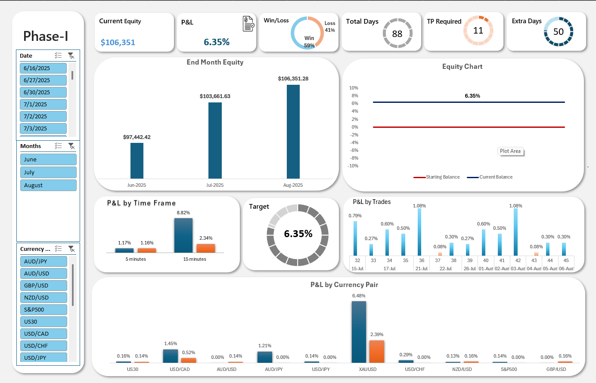

# Trading Performance Dashboard (Excel)

An interactive Excel dashboard that turns a trade journal into performance analytics: equity growth,
profit and loss by month, instrument, time frame and direction, win/loss ratio, and progress toward a
monthly target. Built as a freelance analytics project.

## What it does
- **Trade journal:** one row per trade (date, instrument, position size, time frame, direction, entry,
  stop loss, take profit, exit, commission). Risk/reward, net P&L, P&L %, running balance and month-end
  equity are calculated automatically.
- **Dashboard:** 13 linked charts built on 10 pivot tables, including end-month equity, an equity curve,
  P&L by time frame, P&L by currency pair, P&L by direction, and doughnut KPI gauges for win rate and
  target progress.
- **Interactive filtering:** slicers for trade month, currency pair and date update every chart at once.
- **Target tracking:** compares current equity with the monthly profit target and the trading days remaining.

## Workbook structure
| Sheet | Purpose |
|---|---|
| `Dashboard` | Main visual summary: KPI cards, charts and slicers |
| `My_Journal` | Trade log where new trades are entered |
| `Chart_Data` | Pivot tables that feed the charts |
| `Working` | Intermediate calculations: targets, capacity and KPI formulas |
| `List Variable` | Drop-down lists (instruments, signals, time frames, directions) for consistent data entry |

## How to use
1. Download `Trading-DashBoard.xlsx` and open it in Microsoft Excel 2016 or later (slicers need a recent version).
2. Add trades in `My_Journal` using the drop-down lists.
3. Go to **Data → Refresh All** to update the pivot tables and charts.
4. Use the slicers on `Dashboard` to filter by month, instrument or date.

## Skills demonstrated
Data modeling in Excel · Pivot tables and pivot charts · Slicers · Calculated KPIs · Data validation ·
Dashboard design for non-technical users

## Tools
Microsoft Excel (formulas, pivot tables, pivot charts, slicers, data validation)

---
Author: [Hafza Noor](https://github.com/hafzanoor)
